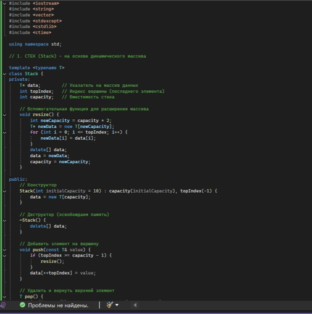
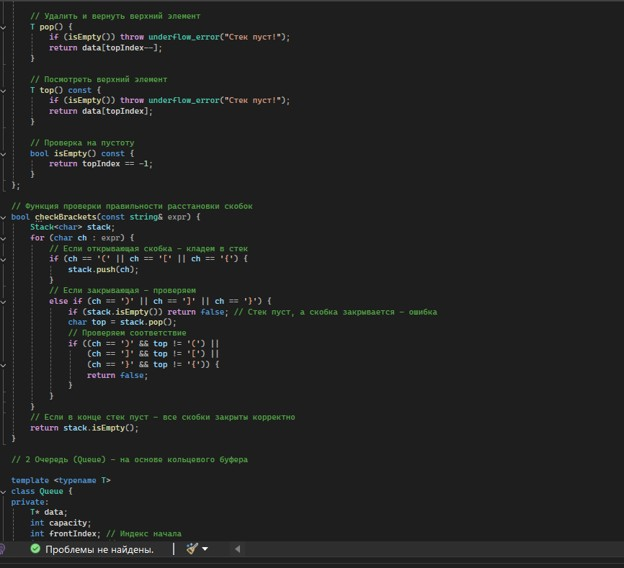
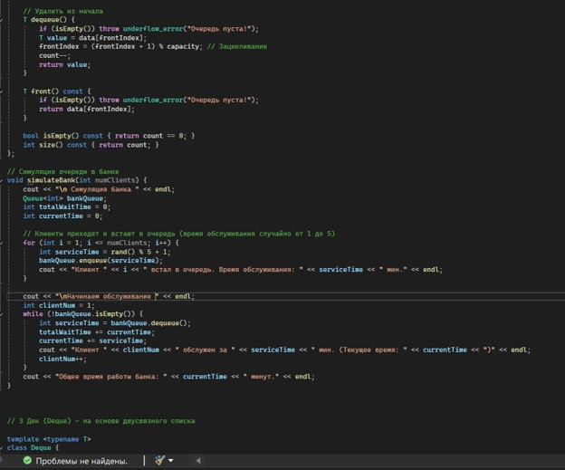
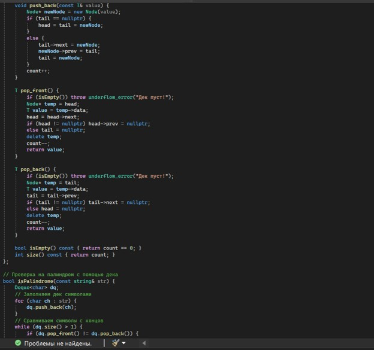
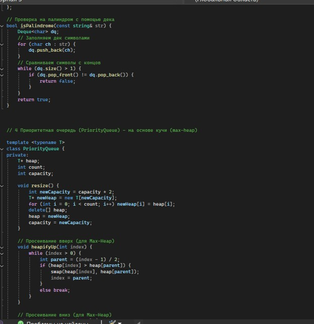
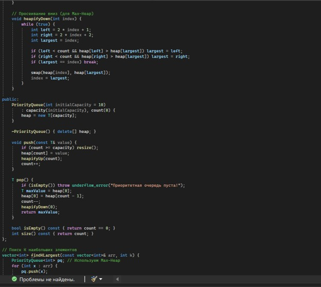
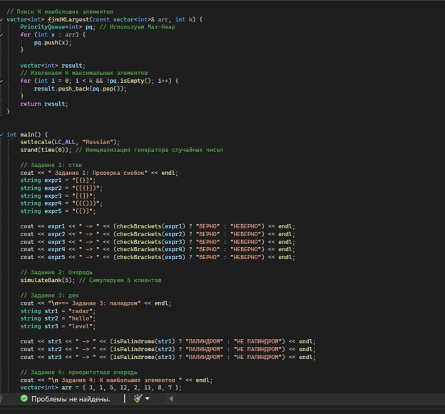
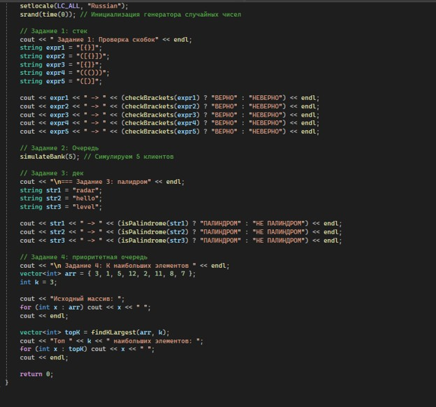
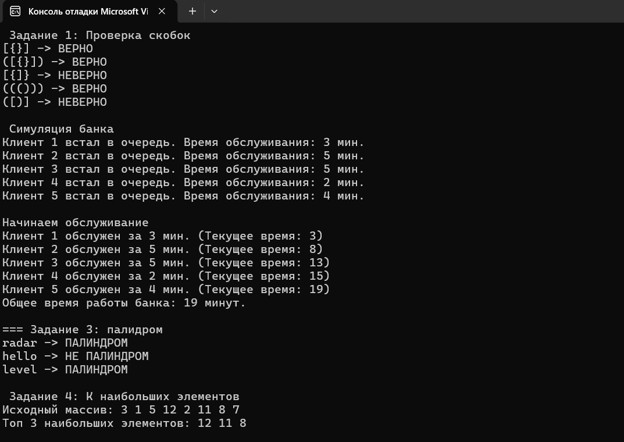

# Лабораторная работа №5
## Стек, очередь, дек, приоритетная очередь

**Выполнила:** *Агафонова Софья Сергеевна*  
**Группа:** *ПИЖ-б-о-25-1*  
**Вариант:** 1 
---

## Цель работы

1. Реализовать шаблонный класс односвязного списка 
(SinglyLinkedList) с базовыми операциями
2. Реализовать шаблонный класс двусвязного списка 
(DoublyLinkedList) с базовыми операциями
3. Освоить операции вставки, удаления, поиска и обхода элементов 
в списках
4. Сравнить производительность и особенности использования 
односвязного и двусвязного списков
5. Научиться правильно управлять памятью при работе со списками 
(удаление узлов)
---

# Теоретическая часть

## 1. Понятие линейных структур данных

**Линейная структура данных** — это структура, в которой элементы расположены последовательно друг за другом, и каждый элемент (кроме первого и последнего) имеет ровно одного предшественника и одного последователя. К линейным структурам относятся: массив, связный список, стек, очередь, дек.

Ключевое различие между структурами — **порядок доступа к элементам**:
- **Стек** — доступ с одного конца по принципу LIFO.
- **Очередь** — добавление с одного конца, извлечение с другого по принципу FIFO.
- **Дек** — доступ с обоих концов.
- **Приоритетная очередь** — извлечение по приоритету, а не по порядку добавления.
---

## 2. Стек (Stack)

### 2.1. Определение и принцип LIFO

**Стек** — это структура данных, работающая по принципу **LIFO** (Last In — First Out, «последним пришёл — первым ушёл»). Элемент, добавленный последним, извлекается первым. Добавление и удаление происходят только с одного конца — **вершины** (top).

**Аналогия:** стопка тарелок — последнюю поставленную тарелку мы возьмём первой. Или стопка книг, где мы кладём и берём книги только сверху.

### 2.2. Основные операции

| Операция | Описание | Сложность |
| :--- | :--- | :--- |
| `push(value)` | Добавляет элемент на вершину стека | `O(1)` |
| `pop()` | Удаляет и возвращает элемент с вершины | `O(1)` |
| `top()` / `peek()` | Возвращает элемент с вершины без удаления | `O(1)` |
| `isEmpty()` | Проверяет, пуст ли стек | `O(1)` |
| `size()` | Возвращает количество элементов | `O(1)` |

### 2.3. Визуализация работы стека

```
push(1): [1]
push(2): [1, 2]
push(3): [1, 2, 3]   ← вершина
pop():   [1, 2]      (возвращает 3)
top():   [1, 2]      (возвращает 2, не удаляя)
```

### 2.4. Реализация на основе динамического массива

Стек можно реализовать на основе динамического массива. Хранятся:
- массив `data` для элементов;
- индекс вершины `topIndex` (изначально `-1`);
- текущая ёмкость `capacity`.

При `push` индекс вершины увеличивается, элемент записывается в массив. При переполнении массив **расширяется** (обычно удвоением ёмкости), что даёт **амортизированную сложность** `O(1)` на операцию. При `pop` возвращается `data[topIndex]`, индекс уменьшается. Преимущество — компактность и кэш-дружественность; недостаток — необходимость реаллокации при росте.

### 2.5. Применение стека

- **Проверка правильности расстановки скобок** — открывающие скобки кладутся в стек, при закрывающей проверяется соответствие вершины.
- **Вычисление выражений в обратной польской записи** — операнды кладутся в стек, при операторе извлекаются два верхних элемента.
- **Перевод чисел между системами счисления** — остатки от деления кладутся в стек и извлекаются в обратном порядке.
- **Обход графов в глубину (DFS)**, откат (backtracking), рекурсия (стек вызовов).

---

## 3. Очередь (Queue)

### 3.1. Определение и принцип FIFO

**Очередь** — это структура данных, работающая по принципу **FIFO** (First In — First Out, «первым пришёл — первым ушёл»). Элемент, добавленный первым, извлекается первым. Добавление происходит в **конец** (rear/tail), удаление — из **начала** (front/head).

**Аналогия:** обычная очередь в магазине или банке — первый в очереди обслуживается первым.

### 3.2. Основные операции

| Операция | Описание | Сложность |
| :--- | :--- | :--- |
| `enqueue(value)` | Добавляет элемент в конец очереди | `O(1)` |
| `dequeue()` | Удаляет и возвращает элемент из начала | `O(1)` |
| `front()` | Возвращает элемент из начала без удаления | `O(1)` |
| `isEmpty()` | Проверяет, пуста ли очередь | `O(1)` |
| `size()` | Возвращает количество элементов | `O(1)` |

### 3.3. Визуализация работы очереди

```
enqueue(1): [1]
enqueue(2): [1, 2]
enqueue(3): [1, 2, 3]
dequeue():  [2, 3]   (возвращает 1)
front():    [2, 3]   (возвращает 2, не удаляя)
```

### 3.4. Реализация на основе кольцевого буфера

При реализации очереди на обычном массиве возникает проблема: после нескольких `dequeue` начало массива «пустеет», и при добавлении новых элементов приходится сдвигать все элементы (`O(n)`). Решение — **кольцевой буфер** (circular buffer):

- хранятся массив `data`, индексы `frontIndex` и `rearIndex`, счётчик `count`;
- при `enqueue`: `data[rearIndex] = value; rearIndex = (rearIndex + 1) % capacity`;
- при `dequeue`: `value = data[frontIndex]; frontIndex = (frontIndex + 1) % capacity`;
- при заполнении массив расширяется с переиндексацией элементов.

Операция взятия остатка `% capacity` обеспечивает «зацикливание» индексов, и обе операции выполняются за `O(1)` (амортизированно).

### 3.5. Применение очереди

- **Симуляция систем массового обслуживания** — очередь в банке, на кассе, обработка заявок.
- **Буферизация данных** — ввод/вывод, передача пакетов в сети.
- **Обход графов в ширину (BFS)** — поиск кратчайшего пути.
- **Планирование задач** в операционных системах (round-robin).

---

## 4. Дек (Deque — Double-Ended Queue)

### 4.1. Определение

**Дек** (double-ended queue, «двусторонняя очередь») — это структура данных, позволяющая добавлять и удалять элементы **с обоих концов**. Дек обобщает стек и очередь: он может работать и как стек (если использовать только один конец), и как очередь.

### 4.2. Основные операции

| Операция | Описание | Сложность |
| :--- | :--- | :--- |
| `push_front(value)` | Добавляет элемент в начало | `O(1)` |
| `push_back(value)` | Добавляет элемент в конец | `O(1)` |
| `pop_front()` | Удаляет элемент из начала | `O(1)` |
| `pop_back()` | Удаляет элемент из конца | `O(1)` |
| `front()` | Возвращает первый элемент | `O(1)` |
| `back()` | Возвращает последний элемент | `O(1)` |
| `isEmpty()` / `size()` | Проверка пустоты / количество элементов | `O(1)` |

### 4.3. Реализация на основе двусвязного списка

Дек удобно реализовать на основе **двусвязного списка**, где каждый узел хранит данные и два указателя — на следующий (`next`) и предыдущий (`prev`) элемент. Хранятся указатели `head` (начало) и `tail` (конец):

- `push_front` создаёт узел и вставляет его перед `head`, обновляя `head`;
- `push_back` вставляет узел после `tail`, обновляя `tail`;
- `pop_front`/`pop_back` удаляют крайний узел, обновляя `head`/`tail` и связи соседей.

Все операции выполняются за `O(1)`, поскольку не требуется обход списка. Альтернатива — кольцевой буфер на массиве (эффективнее по памяти, но требует реаллокации).

### 4.4. Применение дека

- **Проверка строки на палиндром** — символы сравниваются с обоих концов.
- **Скользящее окно** — поиск максимумов/минимумов в подмассивах фиксированной длины.
- **История действий** (undo/redo) с доступом с обоих концов.
- **Алгоритмы планирования** с приоритетным доступом к обоим концам.

---

## 5. Приоритетная очередь (Priority Queue)

### 5.1. Определение

**Приоритетная очередь** — это структура данных, в которой каждый элемент имеет **приоритет**, и элемент с наибольшим (или наименьшим) приоритетом извлекается первым, независимо от порядка добавления. Это обобщение очереди: при равных приоритетах порядок может быть FIFO.

Приоритетная очередь обычно реализуется на основе **двоичной кучи** (binary heap) — это обеспечивает эффективный баланс между скоростью вставки и извлечения.

### 5.2. Основные операции

| Операция | Описание | Сложность |
| :--- | :--- | :--- |
| `push(value)` | Добавляет элемент | `O(log n)` |
| `pop()` | Удаляет элемент с наибольшим приоритетом | `O(log n)` |
| `top()` | Возвращает элемент с наибольшим приоритетом | `O(1)` |
| `isEmpty()` / `size()` | Проверка пустоты / количество элементов | `O(1)` |

### 5.3. Двоичная куча (binary heap)

**Куча** — это полное двоичное дерево, хранящееся в массиве, для которого выполняется **свойство кучи**:
- в **max-heap** значение в каждом узле не меньше значений его потомков (в корне — максимум);
- в **min-heap** значение в каждом узле не больше значений потомков (в корне — минимум).

Для узла с индексом `i` (при нумерации с 0):
- левый потомок — `2i + 1`;
- правый потомок — `2i + 2`;
- родитель — `(i - 1) / 2`.

**Восстановление свойства кучи:**
- `heapifyUp` (просеивание вверх) — после вставки в конец элемент поднимается, пока не встанет на место (не больше `log n` шагов);
- `heapifyDown` (просеивание вниз) — после извлечения корня последний элемент ставится в корень и опускается, пока свойство не восстановится.

Именно эти операции дают сложность `O(log n)` для `push` и `pop`, а корень (максимум/минимум) доступен за `O(1)`.

### 5.4. Почему куча, а не другие структуры?

| Реализация | `push` | `pop` (извлечь max) | `top` |
| :--- | :--- | :--- | :--- |
| Несортированный массив | `O(1)` | `O(n)` (поиск max) | `O(n)` |
| Сортированный массив | `O(n)` (вставка) | `O(1)` | `O(1)` |
| Двоичная куча | `O(log n)` | `O(log n)` | `O(1)` |

Куча даёт **сбалансированную** сложность и компактное хранение в массиве без указателей.

### 5.5. Применение приоритетной очереди

- **Планировщики задач** — процессы с разными приоритетами.
- **Алгоритм Дейкстры** — поиск кратчайших путей.
- **Алгоритм Прима** — построение минимального остовного дерева.
- **Поиск K наибольших/наименьших элементов** — поддержание кучи размера K.
- **Сортировка кучей (Heap Sort)** — `O(n log n)`.
- **Медиана потока чисел** — две кучи (max-heap и min-heap).
- **Обработка событий** в симуляциях (события с earliest time извлекаются первыми).

---

## 6. Сравнение структур данных

| Структура | Принцип доступа | Добавление | Извлечение | Типичная реализация |
| :--- | :--- | :--- | :--- | :--- |
| Стек | LIFO | с вершины `O(1)` | с вершины `O(1)` | динамический массив |
| Очередь | FIFO | в конец `O(1)` | из начала `O(1)` | кольцевой буфер |
| Дек | с обоих концов | в начало/конец `O(1)` | из начала/конца `O(1)` | двусвязный список / кольцевой буфер |
| Приоритетная очередь | по приоритету | `O(log n)` | `O(log n)` (max) | двоичная куча |

Вывод: выбор структуры определяется порядком доступа к элементам. Стек и очередь оптимальны для строгого порядка LIFO/FIFO, дек — для доступа с обоих концов, а приоритетная очередь — когда важен порядок по приоритету, а не по времени добавления.
---
## Постановка задачи

**Общее задание:** 
Реализовать основные линейные структуры данных (стек, очередь, дек, приоритетную очередь) с использованием динамического массива и связного списка. Освоить принципы LIFO и FIFO.

**Индивидуальное задание (Вариант 1):**

| Структура | Задание |
| :--- | :--- |
| **Стек** | Проверить правильность расстановки скобок в выражении (вида `[{}]`) |
| **Очередь** | Смоделировать очередь в банке (время обслуживания клиентов) |
| **Дек** | Проверить, является ли строка палиндромом (с использованием дека) |
| **Приоритетная очередь** | Найти K наибольших элементов в массиве |

### Требования к реализации:
1. **Стек (Задача о скобках):**
   * Реализовать шаблонный класс `Stack`.
   * Написать функцию `checkBrackets(const std::string& expr)`, которая возвращает `true`, если скобки расставлены верно, и `false` в противном случае.

2. **Очередь (Банк):**
   * Реализовать шаблонный класс `Queue` на основе кольцевого буфера.
   * Написать функцию симуляции, которая принимает количество клиентов и время их обслуживания, а возвращает общее время работы банка или время ожидания конкретного клиента.

3. **Дек (Палиндром):**
   * Реализовать шаблонный класс `Deque` (на основе двусвязного списка или массива).
   * Написать функцию `isPalindrome(const std::string& str)`, использующую методы дека `push_back`, `pop_front`, `pop_back`.

4. **Приоритетная очередь (K наибольших):**
   * Реализовать шаблонный класс `PriorityQueue` на основе двоичной кучи.
   * Написать функцию `findKLargest(const std::vector<int>& arr, int k)`, которая возвращает вектор из K наибольших элементов.

---

## Индивидуальное задание


*Рисунок 1- Код программы*



*Рисунок 2- Код программы*


*Рисунок 3- Код программы*



*Рисунок 4- Код программы*


*Рисунок 5- Код программы*



*Рисунок 6 - Код программы*



*Рисунок 7- Код программы*



*Рисунок 8- Код программы*



*Рисунок 9- Код программы*



*Рисунок 10- Код программы*
## Результаты работы программы


*Рисунок 11- Результат программы*

## Ответы на контрольные вопросы

**1. В чём заключается принцип работы стека (LIFO)?**
Стек работает по принципу **LIFO** (Last In — First Out, «последним пришёл — первым ушёл»). Это означает, что элемент, который был добавлен в стек последним, будет извлечён из него первым. Добавление (`push`) и удаление (`pop`) происходят только с одного конца, который называется вершиной стека. 

**2. В чём заключается принцип работы очереди (FIFO)?**
Очередь работает по принципу **FIFO** (First In — First Out, «первым пришёл — первым ушёл»). Элемент, добавленный в очередь первым, будет извлечён из неё первым. Добавление новых элементов (`enqueue`) происходит строго в конец очереди (хвост), а извлечение (`dequeue`) — строго из начала (голова).

**3. Чем дек отличается от обычной очереди?**
Обычная очередь позволяет добавлять элементы только в конец, а удалять только из начала (или наоборот, в зависимости от реализации, но доступ всегда односторонний для каждой операции). **Дек** (двусторонняя очередь) позволяет добавлять и удалять элементы **с обоих концов** (`push_front`, `push_back`, `pop_front`, `pop_back`). Дек можно использовать и как стек, и как обычную очередь.

**4. Что такое приоритетная очередь? Где она применяется?**
Приоритетная очередь — это структура данных, в которой каждый элемент имеет определенный приоритет. Извлечение элементов происходит не по времени их добавления, а по их приоритету (первыми извлекаются элементы с наивысшим приоритетом). 
**Применяется:** в планировщиках задач операционных систем, в алгоритмах на графах (алгоритм Дейкстры для поиска кратчайшего пути, алгоритм Прима), в симуляциях событий, а также для поиска K наибольших/наименьших элементов.

**5. Как реализовать стек на основе динамического массива?**
Создается массив (выделяется память под определенную емкость `capacity`) и заводится переменная `topIndex` (индекс вершины), изначально равная `-1`. 
*   При добавлении (`push`): если массив полон, его емкость увеличивается (обычно в 2 раза) с копированием старых элементов. Затем `topIndex` увеличивается на 1, и в `data[topIndex]` записывается значение.
*   При удалении (`pop`): значение берется из `data[topIndex]`, а `topIndex` уменьшается на 1.

**6. Как реализовать очередь на основе кольцевого буфера?**
Выделяется массив фиксированной или динамической емкости. Заводятся два индекса: `front` (начало) и `rear` (конец), а также счетчик элементов `count`. 
*   При добавлении (`enqueue`): элемент пишется в `data[rear]`, после чего индекс `rear` сдвигается по кругу: `rear = (rear + 1) % capacity`.
*   При удалении (`dequeue`): значение берется из `data[front]`, индекс `front` сдвигается по кругу: `front = (front + 1) % capacity`. 
Использование операции взятия остатка (`% capacity`) позволяет индексам «зацикливаться» и повторно использовать освободившееся в начале массива место без сдвига элементов.

**7. Почему приоритетную очередь обычно реализуют на куче?**
Двоичная куча (binary heap) обеспечивает оптимальный баланс между скоростью основных операций. Вставка (`push`) и извлечение максимума/минимума (`pop`) выполняются за `O(log n)`, а доступ к максимальному/минимальному элементу (`top`) — за `O(1)`. При этом куча эффективно использует память (реализуется на массиве без указателей), в отличие от сбалансированных деревьев поиска. Использование обычного массива дало бы `O(n)` на извлечение, а сортированного массива — `O(n)` на вставку.

**8. Какова сложность операций push и pop в стеке?**
Сложность обеих операций — **`O(1)`** (константное время). При реализации на динамическом массиве сложность `push` является амортизированной `O(1)`, так как операция расширения массива (удвоение) происходит лишь периодически.

**9. Какова сложность операций enqueue и dequeue в очереди?**
Сложность обеих операций — **`O(1)`**. В кольцевом буфере операции сводятся к записи/чтению по индексу и изменению индексов по модулю. При расширении динамического кольцевого буфера сложность `enqueue` становится амортизированной `O(1)`.

**10. Какова сложность операций в приоритетной очереди? Почему?**
*   `push` (вставка) — **`O(log n)`**.
*   `pop` (извлечение) — **`O(log n)`**.
*   `top` (просмотр) — **`O(1)`**.
*Почему:* В двоичной куче при вставке новый элемент добавляется в конец, а затем «всплывает» (просеивается) вверх до своего места. Высота кучи равна `log n`, поэтому в худшем случае совершается `log n` обменов. При извлечении корень удаляется, на его место ставится последний элемент, который затем «погружается» вниз, что также требует `O(log n)` времени.

**11. Как проверить правильность расстановки скобок с помощью стека?**
Нужно итерироваться по строке. Если встречается открывающая скобка (`(`, `[`, `{`), она помещается в стек. Если встречается закрывающая скобка, то проверяется: 
1. Не пуст ли стек (иначе скобка лишняя). 
2. Соответствует ли верхняя скобка в стеке текущей закрывающей. Если нет — ошибка. Если да — скобка извлекается из стека. 
В конце работы цикла стек должен быть пуст (все скобки закрыты).

**12. Как реализовать очередь на двух стеках? Какова сложность?**
Используются два стека: `in` (для добавления) и `out` (для извлечения). 
*   `enqueue`: элемент всегда кладется в стек `in`.
*   `dequeue`: если стек `out` пуст, все элементы из стека `in` перекладываются в стек `out` (при этом их порядок меняется на обратный). Затем элемент извлекается из `out`.
*Сложность:* Операция `enqueue` — строго `O(1)`. Операция `dequeue` в худшем случае занимает `O(n)` (когда нужно перекладывать элементы), но **амортизированная сложность** составляет `O(1)`, так как каждый элемент перекладывается из `in` в `out` не более одного раза за всё время работы.

**13. Как реализовать дек на основе двусвязного списка?**
Создаются указатели на начало (`head`) и конец (`tail`) списка. 
*   `push_front`: новый узел создается и вставляется перед `head`, указатель `head` обновляется. 
*   `push_back`: новый узел вставляется после `tail`, указатель `tail` обновляется. 
*   `pop_front` / `pop_back`: удаляется соответствующий крайний узел, память освобождается, а `head` / `tail` сдвигаются на следующий / предыдущий узел. Все операции происходят за `O(1)`, так как не требуют перебора элементов.

**14. Как реализовать дек на основе кольцевого буфера?**
Это похоже на реализацию обычной очереди, но с возможностью движения в обе стороны. Заводятся индексы `front` и `rear`. 
*   `push_front`: `front` сдвигается назад по кругу (`front = (front - 1 + capacity) % capacity`), элемент записывается в `data[front]`.
*   `push_back`: элемент записывается в `data[rear]`, `rear` сдвигается вперед (`rear = (rear + 1) % capacity`).
*   `pop_front` и `pop_back` аналогично сдвигают соответствующие индексы навстречу друг другу.

**15. Как реализовать стек с поддержкой получения минимума за O(1)?**
Нужно использовать **два стека**: основной `mainStack` для хранения всех элементов и вспомогательный `minStack` для хранения минимумов.
*   `push(x)`: кладем `x` в `mainStack`. Если `minStack` пуст или `x <= minStack.top()`, кладем `x` в `minStack`. (Если `x` больше текущего минимума, мы не добавляем его в `minStack`).
*   `pop()`: извлекаем элемент из `mainStack`. Если он равен `minStack.top()`, то извлекаем и из `minStack`.
*   `getMin()`: просто возвращаем `minStack.top()`, что занимает `O(1)`.
*(При таком подходе дополнительный стек занимает `O(n)` памяти в худшем случае, но все операции выполняются за `O(1)`).*
---

## Выводы

В ходе выполнения лабораторной работы я:
1. Реализовала основные линейные структуры данных: стек, 
очередь, дек и приоритетную очередь 
2. Освоила принципы LIFO (стек) и FIFO (очередь) 
3. Научилась реализовывать эти структуры на основе 
динамического массива и связного списка 
4. Изучила применение стека для решения задач (проверка скобок, 
обратная польская запись) 
5. Реализовала приоритетную очередь на основе кучи (heap) 
---

**Ссылка на Git-репозиторий с кодом программы:**  
https://github.com/agafonovasofa631-collab/5.git
