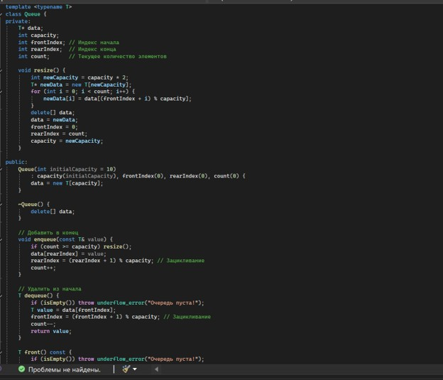
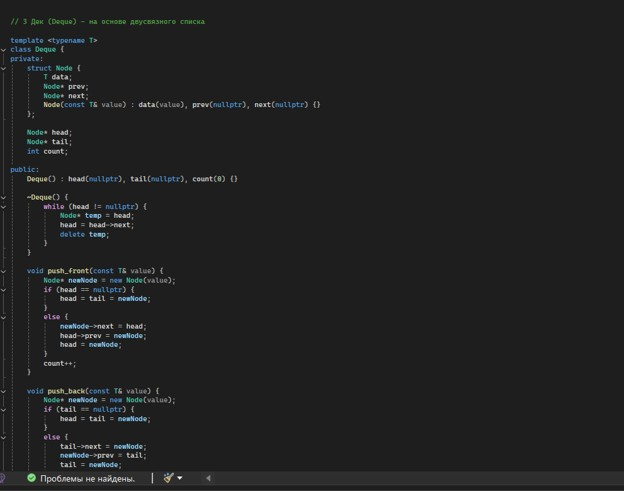

# Лабораторная работа №5
## Стек, очередь, дек, приоритетная очередь

**Выполнила:** *Агафонова Софья Сергеевна*  
**Группа:** *ПИЖ-б-о-25-1*  
**Вариант:** 1 (Продвинутый уровень)

---

## Цель работы

1. Реализовать шаблонный класс односвязного списка 
(SinglyLinkedList) с базовыми операциями
2. Реализовать шаблонный класс двусвязного списка 
(DoublyLinkedList) с базовыми операциями
3. Освоить операции вставки, удаления, поиска и обхода элементов 
в списках
4. Сравнить производительность и особенности использования 
односвязного и двусвязного списков
5. Научиться правильно управлять памятью при работе со списками 
(удаление узлов)

---

# Теоретическая часть

## 1. Понятие линейных структур данных

**Линейная структура данных** — это структура, в которой элементы расположены последовательно друг за другом, и каждый элемент (кроме первого и последнего) имеет ровно одного предшественника и одного последователя. К линейным структурам относятся: массив, связный список, стек, очередь, дек.

Ключевое различие между структурами — **порядок доступа к элементам**:
- **Стек** — доступ с одного конца по принципу LIFO.
- **Очередь** — добавление с одного конца, извлечение с другого по принципу FIFO.
- **Дек** — доступ с обоих концов.
- **Приоритетная очередь** — извлечение по приоритету, а не по порядку добавления.

---

## 2. Стек (Stack)

### 2.1. Определение и принцип LIFO

**Стек** — это структура данных, работающая по принципу **LIFO** (Last In — First Out, «последним пришёл — первым ушёл»). Элемент, добавленный последним, извлекается первым. Добавление и удаление происходят только с одного конца — **вершины** (top).

**Аналогия:** стопка тарелок — последнюю поставленную тарелку мы возьмём первой. Или стопка книг, где мы кладём и берём книги только сверху.

### 2.2. Основные операции

| Операция | Описание | Сложность |
| :--- | :--- | :--- |
| `push(value)` | Добавляет элемент на вершину стека | `O(1)` |
| `pop()` | Удаляет и возвращает элемент с вершины | `O(1)` |
| `top()` / `peek()` | Возвращает элемент с вершины без удаления | `O(1)` |
| `isEmpty()` | Проверяет, пуст ли стек | `O(1)` |
| `size()` | Возвращает количество элементов | `O(1)` |

### 2.3. Визуализация работы стека

```
push(1): [1]
push(2): [1, 2]
push(3): [1, 2, 3]   ← вершина
pop():   [1, 2]      (возвращает 3)
top():   [1, 2]      (возвращает 2, не удаляя)
```

### 2.4. Реализация на основе динамического массива

Стек можно реализовать на основе динамического массива. Хранятся:
- массив `data` для элементов;
- индекс вершины `topIndex` (изначально `-1`);
- текущая ёмкость `capacity`.

При `push` индекс вершины увеличивается, элемент записывается в массив. При переполнении массив **расширяется** (обычно удвоением ёмкости), что даёт **амортизированную сложность** `O(1)` на операцию. При `pop` возвращается `data[topIndex]`, индекс уменьшается. Преимущество — компактность и кэш-дружественность; недостаток — необходимость реаллокации при росте.

### 2.5. Применение стека

- **Проверка правильности расстановки скобок** — открывающие скобки кладутся в стек, при закрывающей проверяется соответствие вершины.
- **Вычисление выражений в обратной польской записи** — операнды кладутся в стек, при операторе извлекаются два верхних элемента.
- **Перевод чисел между системами счисления** — остатки от деления кладутся в стек и извлекаются в обратном порядке.
- **Обход графов в глубину (DFS)**, откат (backtracking), рекурсия (стек вызовов).

---

## 3. Очередь (Queue)

### 3.1. Определение и принцип FIFO

**Очередь** — это структура данных, работающая по принципу **FIFO** (First In — First Out, «первым пришёл — первым ушёл»). Элемент, добавленный первым, извлекается первым. Добавление происходит в **конец** (rear/tail), удаление — из **начала** (front/head).

**Аналогия:** обычная очередь в магазине или банке — первый в очереди обслуживается первым.

### 3.2. Основные операции

| Операция | Описание | Сложность |
| :--- | :--- | :--- |
| `enqueue(value)` | Добавляет элемент в конец очереди | `O(1)` |
| `dequeue()` | Удаляет и возвращает элемент из начала | `O(1)` |
| `front()` | Возвращает элемент из начала без удаления | `O(1)` |
| `isEmpty()` | Проверяет, пуста ли очередь | `O(1)` |
| `size()` | Возвращает количество элементов | `O(1)` |

### 3.3. Визуализация работы очереди

```
enqueue(1): [1]
enqueue(2): [1, 2]
enqueue(3): [1, 2, 3]
dequeue():  [2, 3]   (возвращает 1)
front():    [2, 3]   (возвращает 2, не удаляя)
```

### 3.4. Реализация на основе кольцевого буфера

При реализации очереди на обычном массиве возникает проблема: после нескольких `dequeue` начало массива «пустеет», и при добавлении новых элементов приходится сдвигать все элементы (`O(n)`). Решение — **кольцевой буфер** (circular buffer):

- хранятся массив `data`, индексы `frontIndex` и `rearIndex`, счётчик `count`;
- при `enqueue`: `data[rearIndex] = value; rearIndex = (rearIndex + 1) % capacity`;
- при `dequeue`: `value = data[frontIndex]; frontIndex = (frontIndex + 1) % capacity`;
- при заполнении массив расширяется с переиндексацией элементов.

Операция взятия остатка `% capacity` обеспечивает «зацикливание» индексов, и обе операции выполняются за `O(1)` (амортизированно).

### 3.5. Применение очереди

- **Симуляция систем массового обслуживания** — очередь в банке, на кассе, обработка заявок.
- **Буферизация данных** — ввод/вывод, передача пакетов в сети.
- **Обход графов в ширину (BFS)** — поиск кратчайшего пути.
- **Планирование задач** в операционных системах (round-robin).

---

## 4. Дек (Deque — Double-Ended Queue)

### 4.1. Определение

**Дек** (double-ended queue, «двусторонняя очередь») — это структура данных, позволяющая добавлять и удалять элементы **с обоих концов**. Дек обобщает стек и очередь: он может работать и как стек (если использовать только один конец), и как очередь.

### 4.2. Основные операции

| Операция | Описание | Сложность |
| :--- | :--- | :--- |
| `push_front(value)` | Добавляет элемент в начало | `O(1)` |
| `push_back(value)` | Добавляет элемент в конец | `O(1)` |
| `pop_front()` | Удаляет элемент из начала | `O(1)` |
| `pop_back()` | Удаляет элемент из конца | `O(1)` |
| `front()` | Возвращает первый элемент | `O(1)` |
| `back()` | Возвращает последний элемент | `O(1)` |
| `isEmpty()` / `size()` | Проверка пустоты / количество элементов | `O(1)` |

### 4.3. Реализация на основе двусвязного списка

Дек удобно реализовать на основе **двусвязного списка**, где каждый узел хранит данные и два указателя — на следующий (`next`) и предыдущий (`prev`) элемент. Хранятся указатели `head` (начало) и `tail` (конец):

- `push_front` создаёт узел и вставляет его перед `head`, обновляя `head`;
- `push_back` вставляет узел после `tail`, обновляя `tail`;
- `pop_front`/`pop_back` удаляют крайний узел, обновляя `head`/`tail` и связи соседей.

Все операции выполняются за `O(1)`, поскольку не требуется обход списка. Альтернатива — кольцевой буфер на массиве (эффективнее по памяти, но требует реаллокации).

### 4.4. Применение дека

- **Проверка строки на палиндром** — символы сравниваются с обоих концов.
- **Скользящее окно** — поиск максимумов/минимумов в подмассивах фиксированной длины.
- **История действий** (undo/redo) с доступом с обоих концов.
- **Алгоритмы планирования** с приоритетным доступом к обоим концам.

---

## 5. Приоритетная очередь (Priority Queue)

### 5.1. Определение

**Приоритетная очередь** — это структура данных, в которой каждый элемент имеет **приоритет**, и элемент с наибольшим (или наименьшим) приоритетом извлекается первым, независимо от порядка добавления. Это обобщение очереди: при равных приоритетах порядок может быть FIFO.

Приоритетная очередь обычно реализуется на основе **двоичной кучи** (binary heap) — это обеспечивает эффективный баланс между скоростью вставки и извлечения.

### 5.2. Основные операции

| Операция | Описание | Сложность |
| :--- | :--- | :--- |
| `push(value)` | Добавляет элемент | `O(log n)` |
| `pop()` | Удаляет элемент с наибольшим приоритетом | `O(log n)` |
| `top()` | Возвращает элемент с наибольшим приоритетом | `O(1)` |
| `isEmpty()` / `size()` | Проверка пустоты / количество элементов | `O(1)` |

### 5.3. Двоичная куча (binary heap)

**Куча** — это полное двоичное дерево, хранящееся в массиве, для которого выполняется **свойство кучи**:
- в **max-heap** значение в каждом узле не меньше значений его потомков (в корне — максимум);
- в **min-heap** значение в каждом узле не больше значений потомков (в корне — минимум).

Для узла с индексом `i` (при нумерации с 0):
- левый потомок — `2i + 1`;
- правый потомок — `2i + 2`;
- родитель — `(i - 1) / 2`.

**Восстановление свойства кучи:**
- `heapifyUp` (просеивание вверх) — после вставки в конец элемент поднимается, пока не встанет на место (не больше `log n` шагов);
- `heapifyDown` (просеивание вниз) — после извлечения корня последний элемент ставится в корень и опускается, пока свойство не восстановится.

Именно эти операции дают сложность `O(log n)` для `push` и `pop`, а корень (максимум/минимум) доступен за `O(1)`.

### 5.4. Почему куча, а не другие структуры?

| Реализация | `push` | `pop` (извлечь max) | `top` |
| :--- | :--- | :--- | :--- |
| Несортированный массив | `O(1)` | `O(n)` (поиск max) | `O(n)` |
| Сортированный массив | `O(n)` (вставка) | `O(1)` | `O(1)` |
| Двоичная куча | `O(log n)` | `O(log n)` | `O(1)` |

Куча даёт **сбалансированную** сложность и компактное хранение в массиве без указателей.

### 5.5. Применение приоритетной очереди

- **Планировщики задач** — процессы с разными приоритетами.
- **Алгоритм Дейкстры** — поиск кратчайших путей.
- **Алгоритм Прима** — построение минимального остовного дерева.
- **Поиск K наибольших/наименьших элементов** — поддержание кучи размера K.
- **Сортировка кучей (Heap Sort)** — `O(n log n)`.
- **Медиана потока чисел** — две кучи (max-heap и min-heap).
- **Обработка событий** в симуляциях (события с earliest time извлекаются первыми).

---

## 6. Сравнение структур данных

| Структура | Принцип доступа | Добавление | Извлечение | Типичная реализация |
| :--- | :--- | :--- | :--- | :--- |
| Стек | LIFO | с вершины `O(1)` | с вершины `O(1)` | динамический массив |
| Очередь | FIFO | в конец `O(1)` | из начала `O(1)` | кольцевой буфер |
| Дек | с обоих концов | в начало/конец `O(1)` | из начала/конца `O(1)` | двусвязный список / кольцевой буфер |
| Приоритетная очередь | по приоритету | `O(log n)` | `O(log n)` (max) | двоичная куча |

**Вывод:** выбор структуры определяется порядком доступа к элементам. Стек и очередь оптимальны для строгого порядка LIFO/FIFO, дек — для доступа с обоих концов, а приоритетная очередь — когда важен порядок по приоритету, а не по времени добавления.

## Постановка задачи

**Общее задание:** 
Реализовать оба шаблонных класса — `SinglyLinkedList` (односвязный список) и `DoublyLinkedList` (двусвязный список) — с полной базовой функциональностью (включая корректное управление памятью и деструкторы). Провести сравнение производительности операций для обоих списков.

**Индивидуальное задание:**
Реализовать **итераторы для обоих списков** (методы `begin` и `end`).

### Требования к реализации:
1. **Классы списков:**
   * Реализовать узлы (`Node` и `DNode`) и сами контейнеры с базовыми операциями: `push_front`, `push_back`, `pop_front`, `pop_back`, `find`, `clear`, `size`, `empty`, `print`.
   * Обеспечить строгое управление памятью (освобождение узлов в деструкторе и при удалении элементов).

2. **Реализация итераторов (Вариант 1):**
   * Реализовать вложенные классы итераторов (например, `Iterator` и `ConstIterator`) для обоих списков.
   * Перегрузить необходимые операторы для работы итераторов: разыменование (`*`), доступ к членам (`->`), инкремент (`++`), сравнение (`==`, `!=`).
   * Реализовать методы `begin()` и `end()` (как для константных, так и для неконстантных объектов).
   * Убедиться, что реализованные итераторы позволяют использовать **range-based for** (`for (auto x : list)`).

3. **Сравнение производительности:**
   * Написать демонстрационную программу, которая замеряет время выполнения операций (например, вставка в конец и удаление из начала) для `SinglyLinkedList` и `DoublyLinkedList` на больших объемах данных (например, 10 000 / 100 000 элементов).
---

## Индивидуальное задание


*Рисунок 1- Код программы*


*Рисунок 2- Код программы*



*Рисунок 3- Код программы*


*Рисунок 4- Код программы*



*Рисунок 5- Код программы*
## Результаты работы программы


*Рисунок 6- Результат программы*

## Ответы на контрольные вопросы

**1. Чем связный список отличается от динамического массива?**
Связный список хранит элементы (узлы) в памяти **не непрерывно** (они могут быть разбросаны по куче), связывая их указателями. Динамический массив (например, `std::vector`) хранит элементы в **непрерывной области памяти**. Из-за этого массив обеспечивает быстрый доступ по индексу `O(1)`, но медленную вставку в начало `O(n)`, а список — наоборот.

**2. Какие операции в односвязном списке выполняются за O(1)?**
*   Вставка в начало (`push_front`).
*   Удаление из начала (`pop_front`).
*   Вставка в конец (`push_back`) — **только если** хранится указатель на хвост (`tail`).
*   Вставка после заданного узла (если у нас уже есть указатель на этот узел).

**3. Почему удаление из конца односвязного списка требует O(n) времени?**
Каждый узел односвязного списка хранит указатель только на *следующий* элемент. Чтобы удалить последний узел (`tail`), нужно обнулить указатель `next` у **предпоследнего** узла. Чтобы его найти, необходимо пройти весь список от начала (`head`) до предпоследнего элемента, что занимает `O(n)` времени.

**4. Какие преимущества даёт хранение указателя tail в односвязном списке?**
Указатель `tail` позволяет выполнять вставку нового элемента в конец списка (`push_back`) за время `O(1)`. Без него пришлось бы каждый раз проходить весь список целиком, чтобы найти последний элемент (что заняло бы `O(n)`).

**5. Чем двусвязный список отличается от односвязного?**
В узлах двусвязного списка хранится **два указателя**: на следующий узел (`next`) и на предыдущий (`prev`). Это позволяет обходить список в обоих направлениях (от начала к концу и наоборот), но требует больше памяти под каждый узел.

**6. Какие операции в двусвязном списке выполняются быстрее, чем в односвязном?**
*   **Удаление из конца** (`pop_back`) — выполняется за `O(1)`, так как от `tail` можно сразу перейти к предпоследнему узлу по указателю `prev`.
*   **Удаление или вставка перед заданным узлом** — выполняется за `O(1)`, если есть указатель на этот узел (не нужно искать предыдущий).

**7. Что такое «голова» (head) и «хвост» (tail) списка?**
*   **Head (голова)** — это указатель на самый первый узел списка. С него начинается любой обход. Если список пуст, `head == nullptr`.
*   **Tail (хвост)** — это указатель на самый последний узел списка (у которого указатель `next` равен `nullptr`).

**8. Как удалить узел из середины односвязного списка?**
Нужно найти узел, стоящий **перед** удаляемым (пройти `O(n)` шагов от начала). Затем сохранить указатель на удаляемый узел, перекинуть указатель `next` предыдущего узла на узел *после* удаляемого, и освободить память (`delete`) удаляемого узла.

**9. Как удалить узел из середины двусвязного списка? Почему это проще?**
Если у нас есть указатель на удаляемый узел, удаление занимает `O(1)`. Нужно просто связать его соседей напрямую: 
`node->prev->next = node->next;`
`node->next->prev = node->prev;`
Это проще, потому что благодаря указателю `prev` нам **не нужно искать предыдущий узел** с начала списка.

**10. Что произойдёт, если забыть обновить tail при удалении?**
Указатель `tail` будет указывать на уже освобожденную память (появится «висячий» указатель / dangling pointer). Если после этого вызвать `push_back`, программа попытается записать данные в несуществующий узел, что приведет к неопределенному поведению (ошибке сегментации или повреждению памяти).

**11. Как реализовать реверс односвязного списка?**
Нужно использовать три указателя (`prev = nullptr`, `current = head`, `next = nullptr`). Проходя по списку циклом, на каждом шаге сохраняем `next = current->next`, переворачиваем указатель (`current->next = prev`), сдвигаем `prev = current` и `current = next`. В конце нужно обновить `head = prev`.

**12. Как обнаружить цикл в связном списке?**
С помощью алгоритма Флойда («черепаха и заяц»). Заводятся два указателя: медленный (делает 1 шаг) и быстрый (делает 2 шага). Если в списке есть цикл, быстрый указатель рано или поздно догонит медленный и они встретятся. Если быстрый дойдет до `nullptr`, значит цикла нет.

**13. В каких случаях стоит использовать список вместо массива?**
Когда требуется частая вставка и удаление элементов в начале или середине контейнера (особенно при наличии итераторов/указателей на место вставки). Также списки выгодны, когда заранее неизвестен точный размер данных (нет затрат на реаллокацию) и когда важна стабильность адресов элементов (узлы не перемещаются в памяти при добавлении новых).

**14. Какая дополнительная память требуется для каждого узла списка?**
*   Для **односвязного** списка: память под данные + 1 указатель (`next`).
*   Для **двусвязного** списка: память под данные + 2 указателя (`next` и `prev`).
*(Также может добавляться выравнивающая память (padding) на усмотрение компилятора).*

**15. Почему доступ по индексу в списке имеет сложность O(n)?**
Элементы списка не лежат в памяти друг за другом (непрерывно). Нельзя вычислить адрес нужного элемента по математической формуле (как в массиве). Чтобы добраться до элемента с индексом i, нужно всегда начинать с головы (head) и переходить по указателям next ровно i раз.
---

## Выводы

В ходе выполнения лабораторной работы я:
1. Реализовала шаблонный класс односвязного списка 
(SinglyLinkedList) с базовыми операциями
2. Реализовала шаблонный класс двусвязного списка 
(DoublyLinkedList) с базовыми операциями
3. Освоила операции вставки, удаления, поиска и обхода элементов 
в списках
4. Сравнила производительность и особенности использования 
односвязного и двусвязного списков
5. Научилась правильно управлять памятью при работе со списками 
(удаление узлов)

---

**Ссылка на Git-репозиторий с кодом программы:**  
https://github.com/agafonovasofa631-collab/4.git
